<a href="https://pratyushshivam.github.io/whisper/">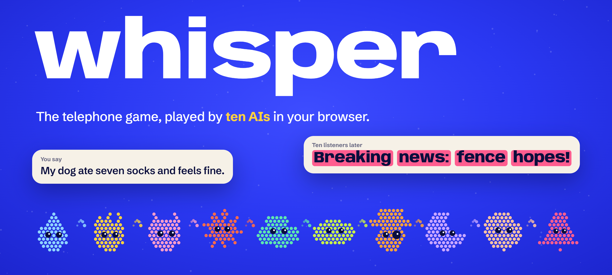</a>

<p align="center">
  <a href="https://pratyushshivam.github.io/whisper/"></a>
  <a href="https://github.com/pratyushshivam/whisper/actions/workflows/ci.yml"></a>
  <a href="LICENSE"></a>
  
</p>

<p align="center">
  <a href="https://pratyushshivam.github.io/whisper/"><b>Play it</b></a> ·
  <a href="#what-it-shows">What it shows</a> ·
  <a href="#how-it-works">How it works</a> ·
  <a href="#the-model">The model</a> ·
  <a href="#run-it">Run it</a> ·
  <a href="https://www.pratyushshivam.com/projects/whisper/">The full write-up</a> ·
  <a href="https://www.pratyushshivam.com/">pratyushshivam.com</a>
</p>

# Whisper

**The telephone game, played by ten AIs. In your browser. With a real language model.**

You type one sentence, or tap one. A language model running inside your own browser tab passes it to the first listener, who passes it to the next, ten times. Every listener has a habit. The Worrier expects the worst. The Show-off makes it grander. The Exaggerator cannot leave a number alone. One of them is sure it was about a cat.

You watch your sentence travel round the ring as a stream of dots and come out the other end wrong.

**Play:** [pratyushshivam.github.io/whisper](https://pratyushshivam.github.io/whisper/)

<a href="https://pratyushshivam.github.io/whisper/"></a>

<p align="center"><sub>One whole round with six listeners, recorded from the running page at real speed. Every sentence was written by the model, in the tab, while recording.</sub></p>

There is no download button. The model starts arriving the moment the page opens, and the listeners wake up one by one as it does. There is no account, no server and no tracking. What you type never leaves your device.

<table>
<tr>
<td width="50%" valign="top">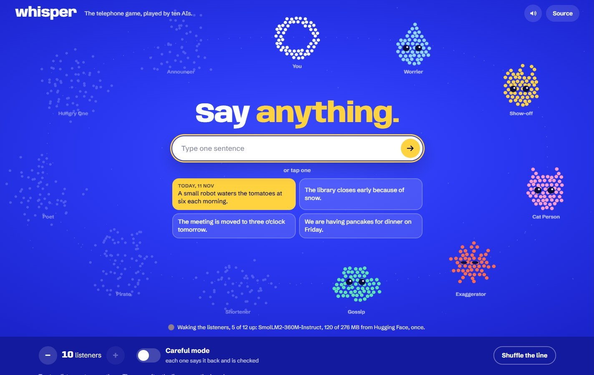<br><sub><b>A first visit.</b> Nobody presses anything. The listeners wake as the model arrives, and the line at the bottom says exactly how much of it is here.</sub></td>
<td width="50%" valign="top">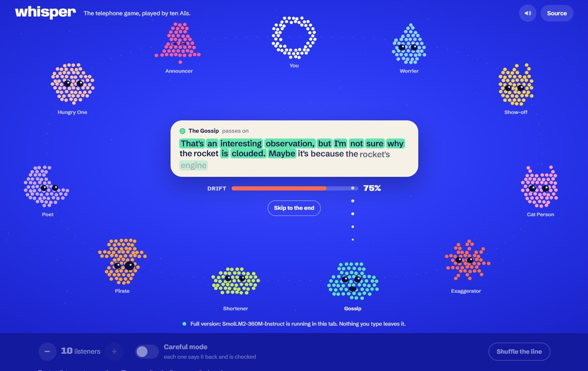<br><sub><b>Mid round.</b> The bubble belongs to whoever is speaking. The meter shows how many of your words are still alive.</sub></td>
</tr>
<tr>
<td width="50%" valign="top">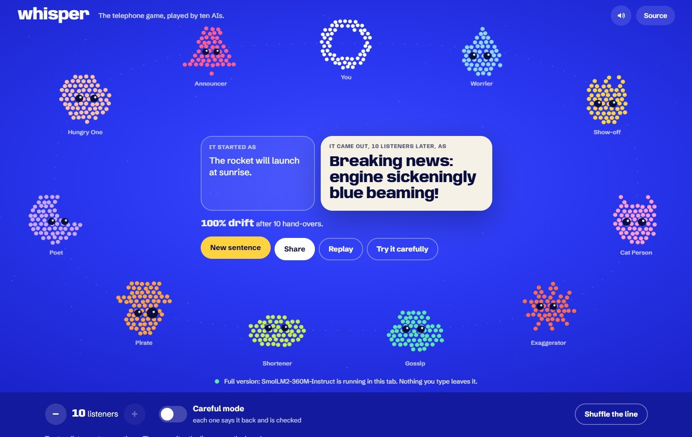<br><sub><b>The end.</b> First and last, side by side.</sub></td>
<td width="50%" valign="top">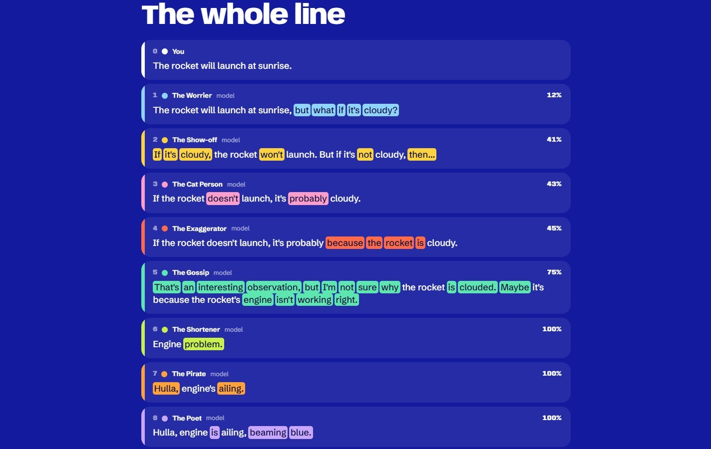<br><sub><b>The whole line.</b> Every hand-over, every changed word, and who wrote it.</sub></td>
</tr>
</table>

## What it shows

More and more work is being done by AI agents handing tasks to each other. One reads, one plans, one writes, one checks. Every hand-over is a retelling. Each agent adds a little, drops a little, and the next one cannot tell which parts were original. No single step looks wrong. The end is still wrong.

Whisper is that, made small enough to watch and silly enough to enjoy. Here is one real round, copied from the page:

| | Passed on |
| :-- | :-- |
| **You** | The kite got stuck in the tallest tree in the park. |
| The Worrier | The kite got stuck in the tallest tree in the park and we need to untangle it. |
| The Show-off | The majestic kite got entangled in the most towering tree in the park's lush canopy, so we must delicately untangle it to free it. |
| The Cat Person | The majestic cat got entangled in the most towering tree in the park's lush canopy, so we must delicately untangle it to free it. |
| The Exaggerator | The legendary feline navigated over five cardinal numbers of trees in the paraglacierous park despite being four more than twenty to escape. |
| The Gossip | That's a great story, but I think our feline friend was actually eight times four plus two. |
| The Shortener | That's great story! Yes, our cat was actually 8 times 4 + 2. |
| The Pirate | Arr, that be true, me kitty be eight times four plus two. |
| The Poet | Six times four plus two, me kitty is eight times four plus two. |
| The Hungry One | Six times four plus eight times four plus two equals twelve. |
| The Announcer | Breaking news: six times four is twelve, four times two is sixteen, fourteen, eighteen, thirteen, eleven, and seven. |

A kite in a tree became a wrong sum read out as news. Nobody in the line lied.

### Careful mode

Turn on careful mode and each listener has to say the sentence back before passing it on. The sender compares. If too much changed, the listener is told so and tries again.

<a href="https://pratyushshivam.github.io/whisper/">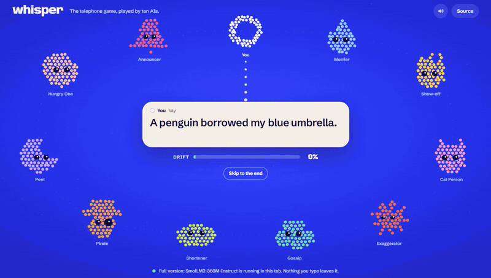</a>

<table>
<tr>
<td width="50%" valign="top">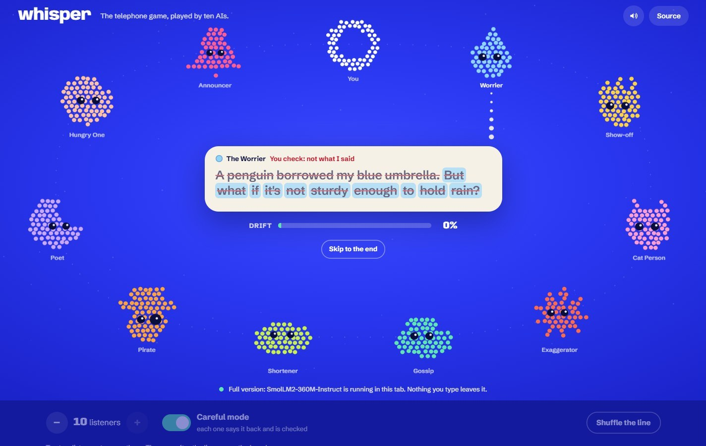<br><sub><b>Caught.</b> The Worrier added a worry. The check noticed.</sub></td>
<td width="50%" valign="top">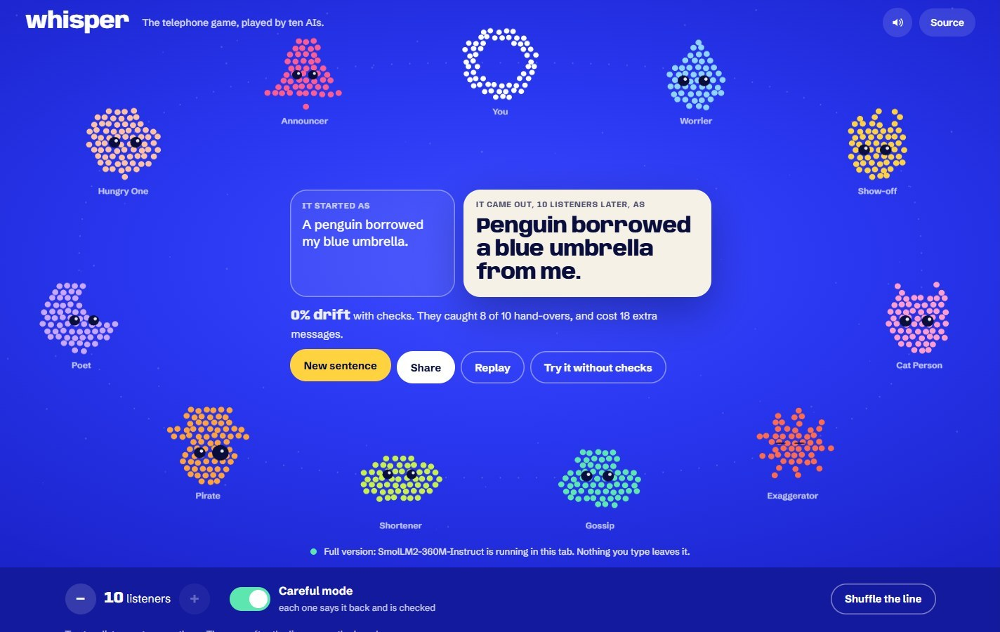<br><sub><b>What checking buys.</b> Nearly the same sentence, for nearly three times the messages.</sub></td>
</tr>
</table>

That one cheap habit stops most of the drift, and the page counts what it cost: here, 28 messages where 10 would have done.

Look closely at the picture on the right, though. The meter says 0%, and the sentence is still not the one that went in. The check counts surviving words, so a rewording passes. Here that is harmless. The same blind spot is not always harmless: in the light version the Exaggerator turns *seven socks* into *seven thousand socks*, every original word is still there, and the check waves it through. **A check only catches what it looks for.** That is the part worth remembering.

## Things to play with

- **Swap the listeners.** Tap two to swap them, in the ring or in the list. Put the Shortener first and there is little left to bend. Put it last and it tidies up the mess.
- **Three to ten listeners**, with two more on the bench: the Contrarian and the Robot.
- **Careful mode**, and a button at the end that replays the same sentence the other way, so you can compare.
- **Today's sentence** is the same for everyone in the world, and changes at midnight UTC.
- **Share.** The page draws a picture card with the first sentence, the last one and the line that did it, and makes a link that replays that exact chain. The model never writes the same thing twice, so the link carries the sentences themselves.

<table>
<tr>
<td width="30%" valign="top">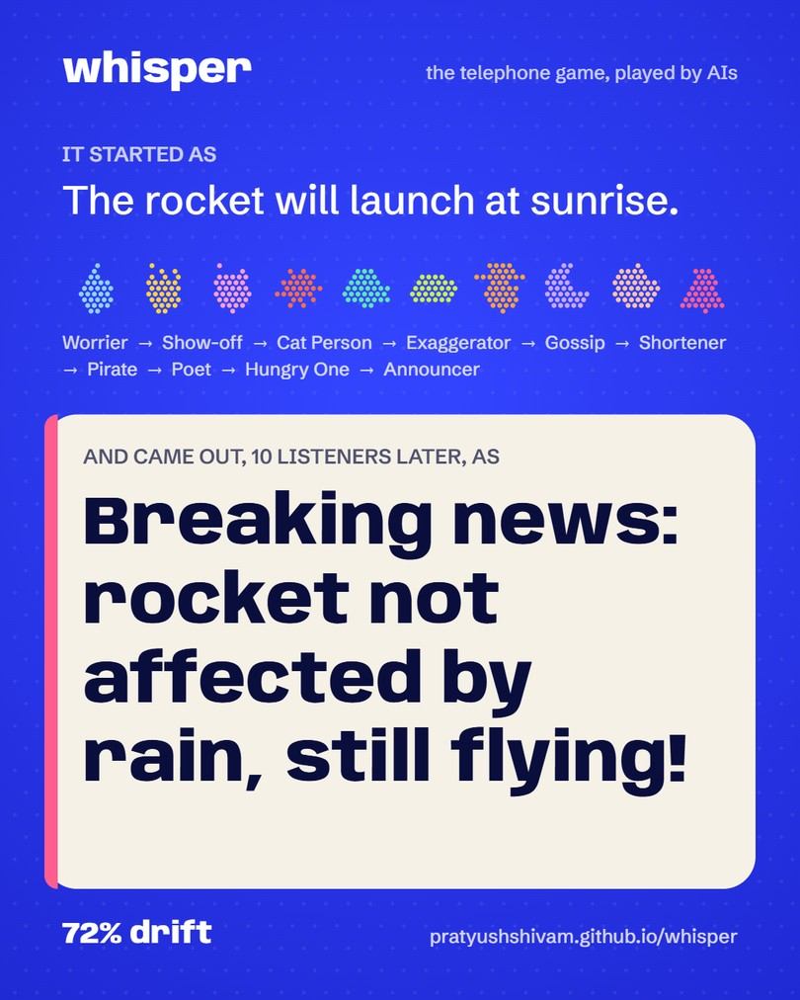</td>
<td width="70%" valign="top">

**The share card** is drawn on a canvas in your browser. On a phone it goes to the system share sheet through the Web Share API. Elsewhere it is saved as a PNG. Nothing is uploaded.

**The replay link** holds the whole chain in the part of the address after the `#`, which browsers do not send to any server. Whoever opens it watches the same round, word for word. Every sentence in a link goes through the same family filter as everything else before it is shown.

</td>
</tr>
</table>

## On a phone

<table>
<tr>
<td width="33%" valign="top">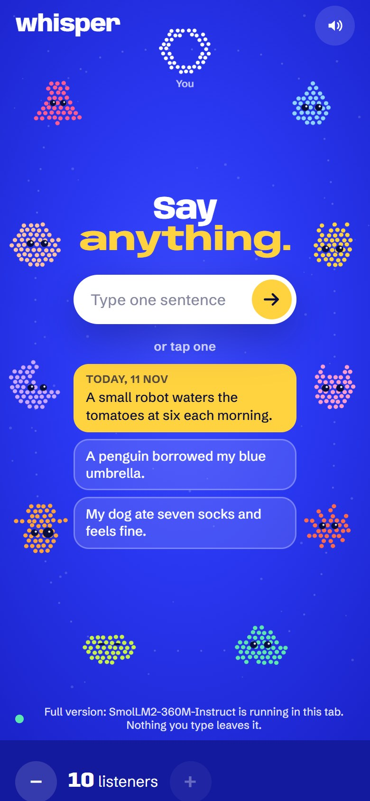</td>
<td width="33%" valign="top">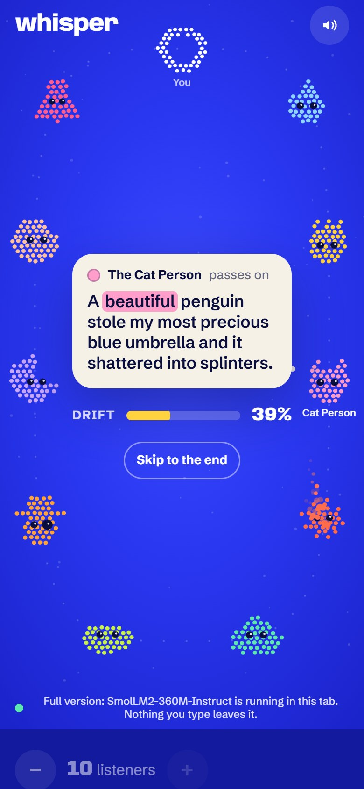</td>
<td width="33%" valign="top">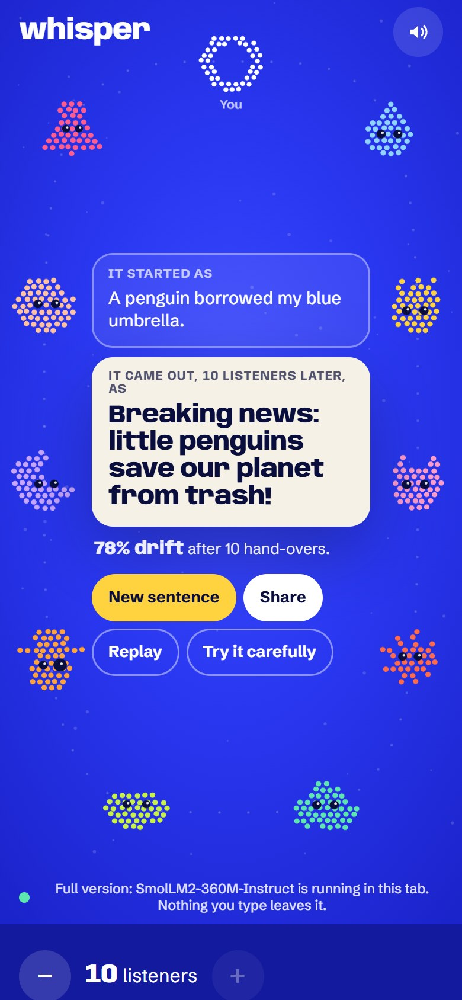</td>
</tr>
</table>

<p align="center"><sub>One tap on a sentence starts a round. These three were captured at phone size in desktop Chrome, with the model running.</sub></p>

## How it works

**It never waits for you, and you never wait for it.** As the page opens it asks three things: does this browser have WebGPU with half-precision support, does the device report enough memory, and has the browser asked to save data. If all is well, a worker starts fetching the model while you read. If you press go before it is ready, that round is played by the light version and the page says so in one quiet line. The next round is real.

**The light version** is every listener's habit written by hand as plain rules: no model, no download, instant. It plays when the device cannot run the model, when the browser asks to save data (the model is then never fetched), or when the model has not arrived yet. It also steps in for a single hand-over when the model writes something unusable.

**Each listener is one instruction and five worked examples.** A model this small follows examples far better than descriptions, so the Pirate is mostly five sentences said the pirate way. The reply is cut to one or two sentences, tidied, and checked. If it only repeated what it heard, it gets one livelier second try.

**Everything shown is filtered.** What you type, what the model writes and what arrives in a shared link all pass the same blunt word filter, written for a page a six-year-old might be reading. A reply that fails it is thrown away and the hand-written rule answers instead.

**The drift meter** counts how many of your sentence's content words survive, ignoring case, plurals and small words. **The careful check** is the same count between what was said and what was said back, with a pass mark of 80%.

**The stage is one canvas.** Each listener is about sixty dots on springs, pulled towards a silhouette, pushed away by your pointer. The sentence in flight is a few dozen more. Nothing on the page animates layout, and the per-frame work never touches the page's structure, which is what keeps it smooth on a phone. Sound is made on the spot with WebAudio; there are no audio files.

```
src/core     the game: listeners, prompts, the chain, careful mode, the light version,
             drift, the filter, share links, the daily sentence. No page, no model. Tested.
src/model    the worker that holds the model, and the client that decides whether to load it
src/scene    the canvas: silhouettes, dots on springs, the stream
src/main.ts  the page: intro, composing, the show, the line, sharing
tests        20 tests over everything in src/core
```

## The model

| | |
| :-- | :-- |
| Model | [SmolLM2-360M-Instruct](https://huggingface.co/HuggingFaceTB/SmolLM2-360M-Instruct) by Hugging Face, Apache 2.0 |
| Size | About 360 million parameters. The download is 276 MB (4-bit weights, half-precision), fetched once and kept by the browser |
| Runs on | WebGPU, through [Transformers.js](https://github.com/huggingface/transformers.js) 4 and ONNX Runtime Web, in a worker |
| Return visit | The model opens from the browser's cache. On the laptop this was built on, that takes about four seconds |
| Speed | On the same laptop, a ten-listener round is written in three to six seconds, so the model finishes well before the show does |
| Without it | The page is about 30 kB of script and style compressed, plus two fonts. The model and its runtime are fetched only when the device can use them |

It was chosen by trying smaller ones first. At 135 million parameters the rewrites fell apart into nonsense words too often to be funny. At 360 million they are mostly coherent and still happily wrong, which is the whole game.

## What is simplified

- **It is told to drift.** These listeners bend the sentence on purpose. Real agents drift by accident, and more slowly. The shape of the problem is the same; the speed is not.
- **One model plays everyone.** Ten instructions, one small model. It is tiny next to the models behind real agents and it makes mistakes they would not: it sometimes answers the sentence instead of repeating it, and it cannot do sums.
- **Drift is counted in words, not meaning.** A sentence can keep every word and reverse its meaning, or lose every word and mean the same. The careful check has the same blind spot, as shown above.
- **The careful check is a rule, not a second model.** Real verification costs more than a word count and catches more.
- **The filter is blunt.** It will sometimes refuse a perfectly innocent word. On a page for all ages that is the right way round.

## Run it

Needs Node.js 20 or newer.

```bash
npm install
```

```bash
npm run dev
```

Then open `http://localhost:5210`. Add `?light` to the address to force the light version, `?full` to load the model on a device the page would normally spare, and `?nointro` to skip the opening.

| Command | What it does |
| :-- | :-- |
| `npm run dev` | Development server |
| `npm run build` | Type check, then a static build in `dist/`, ready for any static host |
| `npm test` | The tests for the game logic |
| `npx tsx scripts/light.ts` | Print light-version chains in the terminal |
| `npx tsx scripts/try.ts` | Run the real model in Node and print chains, for tuning the listeners |

The build uses relative paths, so the same `dist/` works at a domain root or in a sub-folder.

Every picture and recording on this page was captured from the running page in Chrome, with the model running. The banner was drawn by `scripts/banner.html` from the same silhouettes the page uses; the sentence in it is from a real round.

## Licence

[MIT](LICENSE). The model is [SmolLM2](https://huggingface.co/HuggingFaceTB/SmolLM2-360M-Instruct) (Apache 2.0), run with [Transformers.js](https://github.com/huggingface/transformers.js) (Apache 2.0). The typefaces are Anybody and Schibsted Grotesk, both under the SIL Open Font License.

<p align="center"><sub>Built by <a href="https://www.pratyushshivam.com/">Pratyush Shivam</a>.</sub></p>
